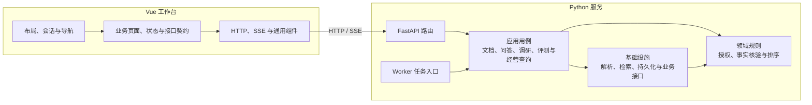
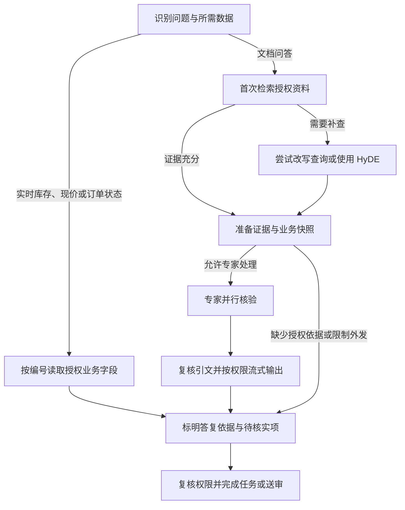

# 淘智 · TaoZhi-EcomAgent

[](https://github.com/SenpeWang/TaoZhi-EcomAgent/actions/workflows/ci.yml)

淘智是面向电商团队的 AI 工作台。运营人员可以从获准阅读的商品资料中查找答案，按已发布的指标查询经营数据，或委派智能体调研竞品与货源。在轨迹中台可以看到哪个智能体在何时检索资料、准备上下文、调用模型或执行工具。

[快速开始](#快速开始) · [系统架构](#系统架构) · [权限与轨迹](#权限与轨迹) · [部署与运维](#部署与运维) · [开发与贡献](#开发与贡献) · [文档索引](#文档索引)

## 工作台能力

| 场景 | 工作台如何处理 |
| --- | --- |
| 企业知识问答 | 在问答页提交问题、跟进处理进度和流式答复，按编号打开获准查看的引用原文。历史提问可按内容筛选，依据不足时可补充条件再次提问。 |
| 经营问数（ChatBI） | 将问题匹配到已发布且获授权的指标，用预定义 SQL 模板查询，返回表格与口径说明。历史答案在读取和审核时复核指标权限。 |
| 市场调研 | 协调器分派公开网页、竞品或货源查询，子智能体按预算调用工具并汇总证据。工作台流式展示进度与报告草稿，运行中的调研可接收补充指令。 |
| Agent 评测中心 | 在「运行分析」查看已归档的评测批次，比较基线、检查失败用例的预期与实际步骤。管理员可筛选本租户发起人，成员可查看本人的批次。[评测与入库](evals/README.md#agent-调研评测) |
| 资料治理 | 上传、解析、审核和发布资料，按组织、密级和个人授权控制访问。读权限、下载权限与外部模型处理权限分别判定。 |

调研 Agent 可调用内置 MCP 工具 `get_current_time` 读取当前时间。默认时区为 `Asia/Shanghai`，也可传入 `{"timezone":"Europe/London"}` 等 IANA 时区。结果包含 `current_time`（带 UTC 偏移的 ISO 8601 时间）和 `timezone`。

## 系统架构

[](web/src/assets/system-architecture.svg)

浏览器向 FastAPI 提交任务，API 校验会话和权限后将任务写入 PostgreSQL。启用 Kafka 时，同一事务还会写入 outbox，由 Worker 转发任务编号。Worker 也会轮询数据库，两种方式都需先认领任务，并在发布结果时核对执行版本。问答入口选择知识检索或受控问数，调研入口运行独立的多智能体工作流。[Worker 分发](src/taozhi/server/worker.py) · [问答执行](src/taozhi/application/rag/execution.py) · [调研执行](src/taozhi/application/research/execution.py)

API 通过 SSE 将持久化的任务事件交给浏览器，断线后可携带 `Last-Event-ID` 续读。轨迹中台从同一租户数据库读取 OpenTelemetry 执行节点，可以在任务结束后回看模型、工具、检索和上下文的调用关系。[任务事件接口](src/taozhi/server/routers/tasks.py) · [轨迹查询接口](src/taozhi/server/routers/traces.py)

### 代码分层



结构检索从业务模块入口开始。文档应用模块负责上传、版本和发布审批，基础设施负责逐页提取、向量与附件存储。问答应用层控制 HyDE 的访问权限和模型预算。前端业务模块共享同一请求和事件流底层。[目录契约](STRUCTURE.md)

### 知识问答的执行路径

文档问答最多分派给 3 位业务专家。首次检索证据不足，或启用自适应 HyDE 后精排置信度偏低时，工作流最多补查一次。两轮结果按倒数排名融合（RRF）保留至多 10 条文档证据。核验检查引文、机型和适用条件，结果页分别列出正文采用的来源和仅在检索中出现的资料。明确询问实时库存、现价或订单状态时，工作流按业务编号读取授权系统。轨迹中台记录本次实际经过的节点。[图定义](src/taozhi/application/rag/workflow.py) · [事实核验](src/taozhi/domain/rag_verification.py)



符合缓存条件的独立问答还可在进入图之前复用已核验答复，命中时会重新检查引用权限。实时业务查询、依赖上文的追问和明确要求只看授权原文的问题各自执行本次工作流。需要审核的任务在批准前不向提问者展示答复正文。[问答执行入口](src/taozhi/application/rag/execution.py)

| 提问与资料情况 | 用户看到的答复 |
| --- | --- |
| 「本店的保修期是多久？」 | 引用适用的内部条款。资料缺失时列出待核实项，并提示向售后负责人补充购买渠道、日期和生效条款。公开网页不能证明本店承诺。 |
| 「什么是 USB PD？」 | 内部依据不足且选择「企业资料与官方公开参考」时，展示内置释义和 USB-IF 原文链接。当前公开参考覆盖 USB-C、USB PD、低功耗蓝牙、GTIN 和 SKU，均在本地匹配。 |
| 「这个商品的实时库存是多少？」 | 填写商品编号后展示业务系统返回的可用库存。缺少编号、权限或所需字段时，页面说明查询缺口。 |
| 「现在有货吗？保修多久？」 | 先给出可核实的库存，另列待核实的保修条件。用户可以选择「补充条件再问」，附上适用渠道和型号。 |
| 同一机型、同一适用条件下，资料给出两个保修期限 | 可识别的直接冲突进入待核实事项，按编号核对两份原文。其余有独立依据的结论仍可展示。 |
| 有相关授权原文，但未获准外发或核验模型不可用 | 页面说明原因，并提供相应片段和文档版本，供人工核对。使用公开参考与允许外部 AI 处理资料是两个独立选项。 |

## 快速开始

下面从全新检出目录启动一个只监听本机的测试工作台，使用独立的 `ecom_test` 数据库和合成资料。示例环境为 Linux，需安装 Git、Python 3.10（含 `venv`）、Node.js 24（含 npm）和 Docker。这个示例只用 Docker 运行 PostgreSQL，API 和 Worker 从源码运行。

**1. 获取源码并准备前后端**

```bash
git clone https://github.com/SenpeWang/TaoZhi-EcomAgent.git
cd TaoZhi-EcomAgent
python3.10 -m venv .venv
.venv/bin/python -m pip install -r requirements.lock.txt
npm --prefix web ci
npm --prefix web run build
```

**2. 创建独立测试库**

在新检出目录执行一次。以下命令生成随机数据库口令，将连接写入仅当前用户可读的 `.env.test`，并将数据库绑定到本机的 `15433` 端口。

```bash
umask 077
demo_password="$(.venv/bin/python -c 'import secrets; print(secrets.token_hex(24))')"
docker run -d --name taozhi-demo-db -p 127.0.0.1:15433:5432 \
  -e POSTGRES_USER=taozhi_demo -e POSTGRES_DB=ecom_test \
  -e POSTGRES_PASSWORD="$demo_password" pgvector/pgvector:pg18
printf 'ECOM_MODE=test\nECOM_TENANT_CODE=mofa\nECOM_DATABASE_URL=postgresql://%s@127.0.0.1:15433/ecom_test\n' \
  "taozhi_demo:$demo_password" > .env.test
unset demo_password
docker exec taozhi-demo-db pg_isready -h 127.0.0.1 -U taozhi_demo -d ecom_test
```

首次初始化可能需要片刻。重复执行最后一条就绪检查，看到 `accepting connections` 后，在仓库根目录运行迁移、导入测试账号与资料，并启动 API。

```bash
export ECOM_ENV_FILE="$PWD/.env.test" PYTHONPATH=src
.venv/bin/python -m alembic upgrade head
.venv/bin/python -c 'from scripts.manage_database import seed_test; seed_test()'
.venv/bin/python -m uvicorn taozhi.server.api:app --host 127.0.0.1 --port 18080
```

**3. 启动 Worker 并体验第一条轨迹**

在第二个终端进入同一仓库根目录，启动处理异步任务的进程。

```bash
ECOM_ENV_FILE="$PWD/.env.test" PYTHONPATH=src .venv/bin/python -m taozhi.server.worker
```

打开 [本机工作台](http://127.0.0.1:18080)。使用测试租户 `mofa`、员工账号 `staff` 和测试口令 `123456` 登录，在知识问答中提交「店铺运营组负责什么工作？」随后打开「轨迹中台」，选择这次提问，查看「执行记录」。切换为同一测试租户的 `admin` 账号，可按发起人查到员工的这次提问。未配置模型凭据时仍可查看检索步骤。要观察一次真实模型调用，在私有配置中填入 `BASE_URL`、`API_KEY` 和 `MODEL`，重启 API、Worker 后重新提问。[测试夹具](scripts/manage_database.py) · [配置示例](.env.example)

体验结束时，在两个终端分别按 `Ctrl+C`，再运行 `docker stop taozhi-demo-db`。下次可用 `docker start taozhi-demo-db` 复用测试库。

## 权限与轨迹

系统管理员在轨迹中台默认查看**本租户全部用户**，可按发起人筛选。其他账号只看本人问答和调研。资料正文另按文档授权读取。需要排查一次失败时，进入该任务的「执行记录」和「问题日志」，按模型 API、工具、检索、上下文、权限、存储或工作流过滤。[轨迹访问规则](src/taozhi/application/services/trace_service.py) · [中文诊断分类](src/taozhi/domain/trace_diagnostic.py)

例如，货源工具正常返回零条商品时，步骤显示为空结果。如果检索网关返回 HTTP 502 并改用备用来源，工具节点会记录中文故障原因、状态码和降级动作。模型请求与结构化响应校验也各有步骤，可用 Trace ID 和 Span ID 将页面上的问题与进程日志对应起来。[工具调用结果](src/taozhi/core/tools/outcome.py) · [OTel 采集](src/taozhi/observability/tracing.py)

## 部署与运维

完整部署使用 Linux、Docker Engine 和支持 `env_file.required` 的 Compose v2。Compose 以 `production` 模式启动服务，默认使用 CPU。向量服务从宿主机只读挂载模型，API 和 Worker 等待迁移成功及中间件就绪后启动。需要 GPU 时使用仓库提供的 NVIDIA 配置。[Compose 编排](docker-compose.yml) · [GPU 覆盖配置](docker-compose.gpu.yml)

| 配置 | 启动前核对 |
| --- | --- |
| 数据库与对象存储 | 从 `.env.example` 创建私有 `.env`，填写 `ECOM_PG_PASSWORD`、`ECOM_MINIO_ACCESS_KEY`、`ECOM_MINIO_SECRET_KEY`。Compose 会将数据库口令拼入连接 URL，宜使用随机十六进制值。 |
| 模型与检索 | `ECOM_MODELS_DIR` 指向模型父目录，嵌入服务需能读取 `bge-small-zh-v1.5`，启用精排时准备 `bge-reranker-v2-m3`。模型生成使用 `BASE_URL`、`API_KEY`、`MODEL`。 |
| 中间件和业务数据 | 按部署目标设置 `ECOM_MINIO_ENABLED`、`ECOM_KAFKA_ENABLED`、`ECOM_ES_ENABLED`。示例文件中三项均为 `false`。使用完整数据通道时设为 `true`。实时库存与订单查询需企业业务接口地址和令牌。 |
| 企业身份 | 迁移负责建表。首次上线需先准备目标租户和公司组织根，再运行 `docker compose exec api python scripts/manage_database.py bootstrap-owner` 为已登记租户创建首位老板账号。后续使用账号与组织管理功能分配权限。 |
| 对外访问 | 应用默认监听 `127.0.0.1:18080`。公网接入使用 HTTPS 反向代理，关闭 SSE 代理缓冲，并启用 `ECOM_COOKIE_SECURE=true`。 |

准备好配置、模型和容器可写的 `data/` 目录后，可在部署主机执行以下命令。健康检查验证服务连通性。首次登录后另验证资料授权、任务执行和轨迹回看。[部署清单](DEPLOY_CHECKLIST.md)

```bash
docker compose config --quiet
docker compose up -d --build
docker compose ps -a
curl -fsS http://127.0.0.1:18080/api/health
curl -fsS http://127.0.0.1:18555/health
```

任务长时间排队时，先用 `docker compose ps -a` 核对迁移退出码与 Worker 状态，再用 `docker compose logs --tail=100 worker` 查看认领和续租日志。备份脚本覆盖 PostgreSQL 与本地私有附件，MinIO 对象需另行备份。恢复演练会创建临时数据库，需要相应权限。[备份与恢复脚本](scripts/backup_database.py)

## 开发与贡献

在已安装锁定依赖的检出目录中运行以下检查。`make test` 读取 `.env.test`，企业集成用例会清空该库的所有租户及关联数据。请使用可丢弃的专用数据库 `ecom_test`。[测试入口](Makefile) · [CI 工作流](.github/workflows/ci.yml)

```bash
make check-repository
make lint-web check-format
make test
```

向 `main` 推送或提交 PR 会触发 GitHub Actions，执行公开文件与提交检查、前端类型检查和构建、数据库迁移、离线回归及评估指标单元测试。Python 源码说明使用 docstring，前端使用中文 JSDoc。ESLint 和 Prettier 检查命名与排版。提交遵循 Conventional Commits，摘要含中文、标题不超过 100 个字符。可用 `make install-hooks` 启用本地 Git 钩子。[前端规则](web/eslint.config.js) · [提交规则](web/commitlint.config.cjs)

反馈问题时请附运行版本、复现步骤和脱敏后的错误码。凭据、客户提问和私有资料请留在企业环境内。仓库提供缺陷、功能与文档反馈表单。[提交反馈](https://github.com/SenpeWang/TaoZhi-EcomAgent/issues/new/choose)

## 文档索引

| 文档 | 适合何时阅读 |
| --- | --- |
| [项目结构与目录职责](STRUCTURE.md) | 定位接口、工作流、权限规则、持久化和前端组件 |
| [数据库说明](DATABASE_SCHEMA.md) · [版本迁移](migrations/versions/) | 理解数据模型，按迁移核对当前表结构 |
| [部署清单](DEPLOY_CHECKLIST.md) · [运行配置](.env.example) | 配置主机、模型、中间件和访问入口 |
| [评估指南](evals/README.md) · [基准与门禁](evals/BENCHMARK.md) | 在隔离评估实例运行知识检索、引文与智能体工具评测，可选将评估结果同步至 Phoenix。在线轨迹由工作台内置的 OTel 采集器记录 |

## 许可证

本仓库当前未提供项目级 `LICENSE` 文件。
