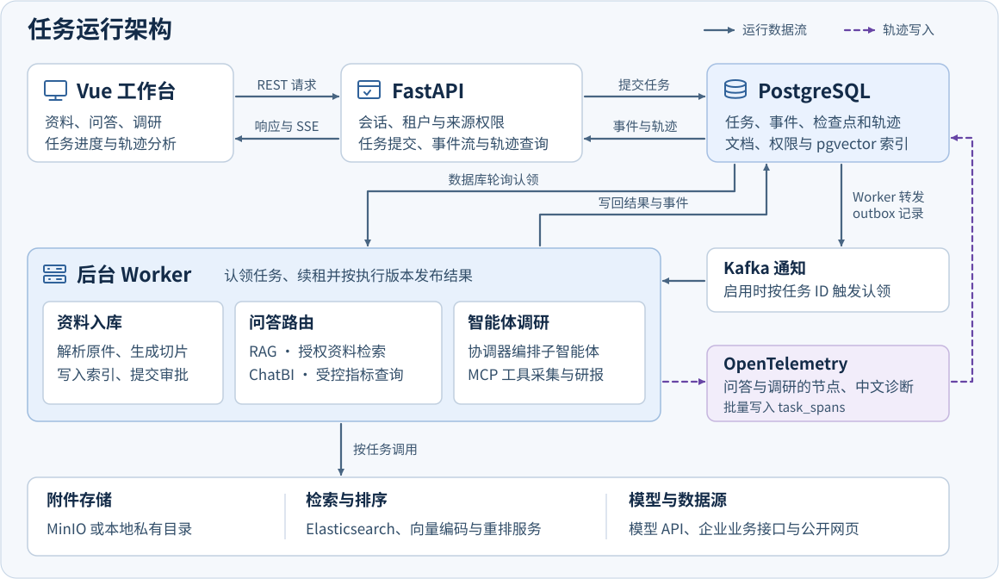
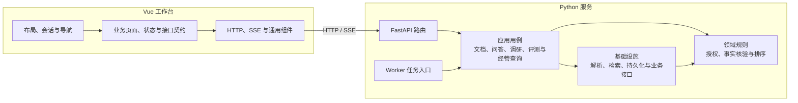

# 淘智 · TaoZhi-EcomAgent

[](https://github.com/SenpeWang/TaoZhi-EcomAgent/actions/workflows/ci.yml)

淘智是面向电商团队的 AI 工作台。运营人员可以从获准阅读的商品资料中查找答案，按已发布的指标查询经营数据，或委派智能体调研竞品与货源。在轨迹中台可以看到哪个智能体在何时检索资料、准备上下文、调用模型或执行工具。

[快速开始](#快速开始) · [系统架构](#系统架构) · [PDF 语料](#手机配件-pdf-语料) · [权限与轨迹](#权限与轨迹) · [部署与运维](#部署与运维) · [开发与贡献](#开发与贡献) · [文档索引](#文档索引)

## 工作台能力

| 场景 | 工作台如何处理 |
| --- | --- |
| 企业知识问答 | 在问答页提交问题、跟进处理进度和流式答复，按编号打开获准查看的引用原文。历史提问可按内容筛选，依据不足时可补充条件再次提问。 |
| 经营问数（ChatBI） | 将问题匹配到已发布且获授权的指标，用预定义 SQL 模板查询，返回表格与口径说明。历史答案在读取和审核时复核指标权限。 |
| 市场调研 | 协调器分派公开网页、竞品或货源查询，子智能体按预算调用工具并汇总证据。工作台流式展示进度与报告草稿，运行中的调研可接收补充指令。 |
| Agent 评测中心 | 在「运行分析」查看已归档的评测批次，比较基线、检查失败用例的预期与实际步骤。管理员可筛选本租户发起人，成员可查看本人的批次。[评测与入库](evals/README.md#agent-调研评测) |
| 资料治理 | 上传、解析、审核和发布资料，按组织、密级和个人授权控制访问。读权限、下载权限与外部模型处理权限分别判定。 |

调研 Agent 可调用内置 MCP 工具 `get_current_time` 读取当前时间。默认时区为 `Asia/Shanghai`，也可传入 `{"timezone":"Europe/London"}` 等 IANA 时区。结果包含 `current_time`（带 UTC 偏移的 ISO 8601 时间）和 `timezone`。

## 系统架构

[](web/src/assets/system-architecture.svg)

浏览器向 FastAPI 提交任务，API 校验会话和权限后将任务写入 PostgreSQL。启用 Kafka 时，同一事务还会写入 outbox，由 Worker 转发任务编号。Worker 也会轮询数据库，两种方式都需先认领任务，并在发布结果时核对执行版本。问答入口选择知识检索或受控问数，调研入口运行独立的多智能体工作流。[Worker 分发](src/taozhi/server/worker.py) · [问答执行](src/taozhi/application/rag/execution.py) · [调研执行](src/taozhi/application/research/execution.py)

API 通过 SSE 将持久化的任务事件交给浏览器，断线后可携带 `Last-Event-ID` 续读。轨迹中台从同一租户数据库读取 OpenTelemetry 执行节点，可以在任务结束后回看模型、工具、检索和上下文的调用关系。[任务事件接口](src/taozhi/server/routers/tasks.py) · [轨迹查询接口](src/taozhi/server/routers/traces.py)

### 代码分层



文档应用模块负责上传、版本和发布审批，基础设施负责逐页提取、向量与附件存储。问答应用层控制 HyDE 的访问权限和模型预算。前端业务模块共用 HTTP 和 SSE 客户端。[目录契约](STRUCTURE.md)

文档问答、实时业务与经营指标各走各自的查询路径。工作流记录答复依据、待核实项与审核状态。[问答路径与证据规则](documentation/knowledge-base.md#问答执行路径)

## 手机配件 PDF 语料

资料覆盖手机壳膜、充电、线材、支架和音频配件。可用清单按品类、型号与地区筛选原始 PDF，也可打开厂商官方手册。原件含版本、页数、SHA-256 和再分发依据，可供后续按页切片。[PDF 原件与来源清单](data/accessory_pdfs/) · [资料与问答手册](documentation/knowledge-base.md)

## 快速开始

在独立的 `ecom_test` 数据库使用合成资料，体验知识问答、执行轨迹与管理员发起人筛选。[本地演示](documentation/quickstart.md)

## 权限与轨迹

系统管理员在轨迹中台默认查看**本租户全部用户**，可按发起人筛选。其他账号只看本人问答和调研。资料正文另按文档授权读取。需要排查一次失败时，进入该任务的「执行记录」和「问题日志」，按模型 API、工具、检索、上下文、权限、存储或工作流过滤。[轨迹访问规则](src/taozhi/application/services/trace_service.py) · [中文诊断分类](src/taozhi/domain/trace_diagnostic.py)

例如，货源工具正常返回零条商品时，步骤显示为空结果。如果检索网关返回 HTTP 502 并改用备用来源，工具节点会记录中文故障原因、状态码和降级动作。模型请求与结构化响应校验也各有步骤，可用 Trace ID 和 Span ID 将页面上的问题与进程日志对应起来。[工具调用结果](src/taozhi/core/tools/outcome.py) · [OTel 采集](src/taozhi/observability/tracing.py)

## 部署与运维

生产环境通过 Docker Compose 运行 API、Worker、迁移和中间件。上线前核对租户、资料权限、反向代理及任务执行。[部署与运维手册](documentation/deployment.md)

## 开发与贡献

在已安装锁定依赖的检出目录中运行以下检查。`make test` 读取 `.env.test`，企业集成用例会清空该库的所有租户及关联数据。请使用可丢弃的专用数据库 `ecom_test`。[测试入口](Makefile) · [CI 工作流](.github/workflows/ci.yml)

```bash
make check-repository
make lint-web check-format
make test
```

向 `main` 推送或提交 PR 会触发 GitHub Actions，执行公开文件与提交检查、前端类型检查和构建、数据库迁移、离线回归及评估指标单元测试。Python 源码说明使用 docstring，前端使用中文 JSDoc。ESLint 和 Prettier 检查命名与排版。提交遵循 Conventional Commits，摘要含中文、标题不超过 100 个字符。可用 `make install-hooks` 启用本地 Git 钩子。[前端规则](web/eslint.config.js) · [提交规则](web/commitlint.config.cjs)

反馈问题时请附运行版本、复现步骤和脱敏后的错误码。凭据、客户提问和私有资料请留在企业环境内。仓库提供缺陷、功能与文档反馈表单。[提交反馈](https://github.com/SenpeWang/TaoZhi-EcomAgent/issues/new/choose)

## 文档索引

| 要做的事 | 从这里开始 |
| --- | --- |
| 体验工作台 | [本地演示](documentation/quickstart.md) |
| 找配件原件、做向量或准备资料入库 | [资料与问答手册](documentation/knowledge-base.md) · [PDF 原件与厂商下载入口](data/accessory_pdfs/) |
| 修改代码或核对数据关系 | [目录契约](STRUCTURE.md) · [数据库模型](documentation/database.md) |
| 配置主机、部署或排查任务积压 | [部署与运维手册](documentation/deployment.md) · [配置示例](.env.example) |
| 构造评测数据、复现判分和归档基线 | [评测指南](evals/README.md) · [基准与门禁](evals/BENCHMARK.md) |

## 许可证

本仓库当前未提供项目级 `LICENSE` 文件。第三方 PDF 均按对应原件的署名和许可使用。[PDF 署名与许可](data/accessory_pdfs/README.md)
