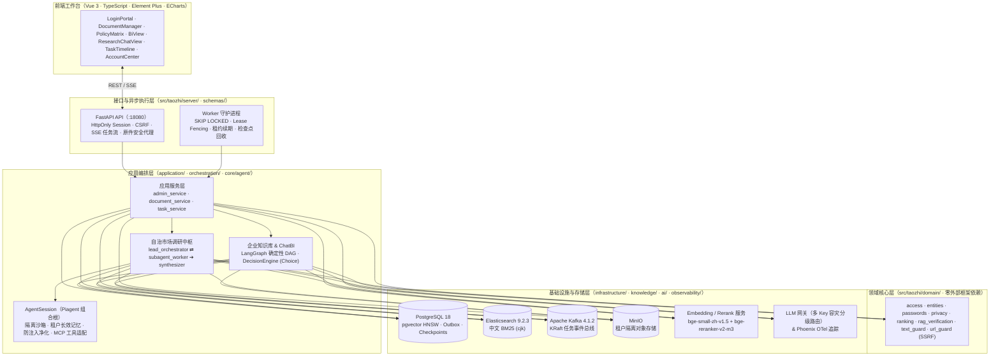
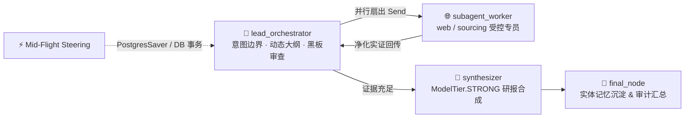

<div align="center">

# 🛍️ TaoZhi-EcomAgent（淘智）

**面向电商企业的知识问答、受控 ChatBI 问数与自治多智能体市场调研中台**

[](https://www.python.org/)
[](https://fastapi.tiangolo.com/)
[](https://github.com/langchain-ai/langgraph)
[](https://vuejs.org/)
[](https://www.postgresql.org/)
[](https://docs.docker.com/compose/)

[核心亮点](#一核心亮点) · [系统架构](#二系统架构) · [双核智能体引擎](#三双核智能体与-rag-引擎) · [容器拓扑](#四全官方镜像容器拓扑) · [快速开始](#五快速开始) · [目录结构](#六项目目录结构) · [评测体系](#七科学评测体系) · [开发与门禁](#八开发规范与质量门禁)

</div>

---

**TaoZhi-EcomAgent（淘智）** 是一套面向电商商品资料管理、售前售后咨询、经营指标问数（ChatBI）与市场全景调研的企业级多智能体工作台。

项目围绕 **“确定性治理 + 自治探索”双核驱动** 构建：对内知识问答与经营数据坚持**权限前置、逐字溯源、白名单受控执行**；对外全网情报与货源比价采用 **LangGraph Supervisor 自治闭环 + 受控沙箱**，并全栈采用 **官方镜像 Docker Compose（支持 NVIDIA GPU 弹性直通）** 一键交付。

> ⚠️ **安全与隐私边界**：本仓库仅公开代码、测试夹具与工程文档。企业机密原件、私有环境配置（`.env*` 除 `.env.example`）、`data/` 目录及业务数据库均受 Git 钩子与仓检门禁拦截，严禁入库。

---

## 一、核心亮点

| 能力维度 | 核心实现 |
| :--- | :--- |
| **双核智能体编排** | **知识库问答**走确定性 LangGraph DAG 工作流；**市场调研**走真·自治多智能体 Supervisor Loop，支持并行扇出（`Send`）、动态重规划与运行期中途干预（Mid-Flight Steering）。 |
| **四层清晰架构与沙箱** | 遵循 Clean Architecture + Piagent 分层契约：`domain/` 零框架依赖；`AgentSession` 统一托管隔离沙箱（Scratch / Artifacts）、租户长效记忆与工具后置防注入净化。 |
| **多租户与三级密级 RBAC** | `公司 ➔ 部门 ➔ 小组 ➔ 成员` 组织树 + `staff / leader / boss / admin` 角色矩阵 + L1/L2/L3 密级、审批临时授权、到期撤权及 `tenants.epoch` 跨进程缓存代际失效。 |
| **四路混合检索与零幻觉门禁** | 权限前置过滤后执行 **ES BM25 + PG pgvector HNSW + 字符 TF-IDF + 自适应 HyDE** 四路 RRF 融合，经 `bge-reranker-v2-m3` 交叉精排与逐字引文核验门禁，无依据坚决拒答。 |
| **受控 ChatBI 语义问数** | 内置 18 项电商经营指标语义层，通过别名匹配与越权早置拦截定位指标，SQL 严格基于白名单模板组装，**禁止大模型自由拼接 SQL**。 |
| **生产级异步与容器编排** | Transactional Outbox + Kafka 分发 + Worker 分布式租约（Lease Fencing）+ SSE 实时任务流 + PostgresSaver 断点恢复；全官方镜像 Docker Compose 一键启停，可选 GPU 加速。 |

---

## 二、系统架构



---

## 三、双核智能体与 RAG 引擎

### 3.1 企业知识库问答 & 受控 ChatBI（Deterministic Workflow）

面向内部商品规格、售后政策与经营指标查询，执行确定性有向无环图（[workflow.py](src/taozhi/application/rag/workflow.py)）：

1. **意图路由与离散决策**：经 [intent.py](src/taozhi/application/rag/intent.py) 与 [decision.py](src/taozhi/orchestration/decision.py)（`DecisionEngine` 强类型 `Choice` 原语，支持本地向量快速直选与规则兜底）区分常识直答、受控问数与知识检索。
2. **受控 ChatBI 问数**：指标越权在进入检索前即被拦截；授权指标经白名单语义模板查询业务库并返回结构化图表数据（`AnswerChart` / `BiView`）。
3. **语义缓存与四路混合检索**：先查对齐 `tenants.epoch` 代际水位的向量语义缓存；未命中时限定授权文档集，融合 **ES BM25 + PG pgvector HNSW + 字符 TF-IDF + 自适应 HyDE**，经 RRF 与 `bge-reranker-v2-m3` 精排。
4. **专职专家协同与逐字核验门禁**：由 [specialists.py](src/taozhi/application/rag/specialists.py) 分角色汇总证据，[rag_verification.py](src/taozhi/domain/rag_verification.py) 强制校验引文逐字溯源与四则计算正确性，发布前再次复核 ACL 权限。

### 3.2 电商智能市场调研（Autonomous Supervisor Loop）

面向竞品趋势、全网口碑与供应链比价调研，采用真正的图环路自治架构（[graph.py](src/taozhi/application/research/graph.py)）：



| 节点标识 | 职责定位 | 绑定工具与安全边界 |
| :--- | :--- | :--- |
| **`lead_orchestrator`** | 调研总指挥（Supervisor） | 自主规划调研大纲、按需动态扇出子智能体、审查黑板证据缺口并决定继续深挖或收敛。 |
| **`subagent_worker`** | 并行专职调研员（`web` / `sourcing`） | 受控挂载 MCP 工具 `search_web`、`fetch_web_page`、`search_1688_wholesale`、`search_amazon`；逐跳经 `url_guard` 防 SSRF，回传经 `AgentSession` 净化，无结果绝不编造。 |
| **`synthesizer` / `final_node`** | 研报编排与记忆沉淀 | 基于实证黑板生成带来源标注的 Markdown 研报，按租户物理隔离写入长效记忆并清理临时沙箱。 |

- **可审计进度与 5 大信标**：按真实决策轮次（Turn 1, Turn 2...）流式推进，不捏造百分比、不倾倒 CoT 草稿，结构化沉淀 `tool_name`、`parameters`、`result_summary`、`state_transition`（如 `lead_orchestrator:PLANNING ➔ subagent_worker:DISPATCHED`）与 `decision_rationale`。

### 3.3 权限矩阵与安全防线

- **四角色 RBAC**：`staff`（组织范围低密级只读）、`leader`（本组织二级审核与内容管理）、`boss`（跨部门及 L3 机密审批与原件下载）、`admin`（账号/组织与系统状态运维，不可自提业务密级权限）。
- **端到端安全控制**：HttpOnly 同源 Cookie + 写操作 CSRF 校验；`boss` 原件下载默认由 `api` 从 MinIO 读取并代理直出（不暴露存储端口、不泄露内网域名）；支持按 `ECOM_MINIO_PUBLIC_ENDPOINT` 切换外部 S3 预签名。

---

## 四、全官方镜像容器拓扑

所有基础设施均采用官方容器镜像，应用与向量推理服务通过单文件三目标 [Dockerfile](Dockerfile) 构建，由 [docker-compose.yml](docker-compose.yml) 统一编排：

| 服务名 | 镜像来源 | 端口策略 | 核心职责与持久化 |
| :--- | :--- | :--- | :--- |
| **`postgres`** | `pgvector/pgvector:pg18` | `127.0.0.1:15432:5432` | 在线业务库、pgvector 向量索引、Outbox 与检查点（卷 `pg_data`） |
| **`minio`** | `minio/minio:latest` | 仅容器内网 `:19000` | 租户隔离原始附件存储与版本管理（卷 `minio_data`） |
| **`kafka`** | `apache/kafka:4.1.2` | 仅容器内网 `:9092` | KRaft 无 ZooKeeper 任务事件总线（卷 `kafka_data`） |
| **`elasticsearch`** | `elasticsearch:9.2.3` | 仅容器内网 `:9200` | 切片中文 BM25 检索，无 IK 插件时自动回落内置 `cjk`（卷 `es_data`） |
| **`embedding`** | `Dockerfile` (`embedding`) | 仅容器内网 `:18555` | 独立隔离 PyTorch/Transformers 推理服务，只读挂载模型目录；默认 CPU，叠加 [docker-compose.gpu.yml](docker-compose.gpu.yml) 启用 CUDA GPU |
| **`migrate`** | `Dockerfile` (`app`) | 一次性任务 | 自动启用 `vector` 扩展并执行 `alembic upgrade head`，成功退出后放行应用 |
| **`api`** | `Dockerfile` (`app`) | `127.0.0.1:18080:18080` | FastAPI 服务端 + 多阶段构建内嵌的 Vue 3 生产静态资源（挂载 `./data`） |
| **`worker`** | `Dockerfile` (`app`) | 无对外端口 | Kafka/DB 异步任务消费、文档解析切片与长链路调研执行（挂载 `./data`） |

> 云端部署与 Nginx 反向代理配置详见 [DEPLOY_CHECKLIST.md](DEPLOY_CHECKLIST.md)。

---

## 五、快速开始

### 前置依赖

- **运行环境**：Docker Engine `24+` 与 Docker Compose v2。
- **可选 GPU 加速**：若宿主机具备 NVIDIA GPU，安装配置 `nvidia-container-toolkit` 即可通过叠加文件启用 `cuda:0`。
- **本地嵌入模型（可选）**：如需启用语义向量与精排，将 `bge-small-zh-v1.5` 与 `bge-reranker-v2-m3` 置于宿主机模型目录并在 `.env` 中通过 `ECOM_MODELS_DIR` 指定（缺失时检索自动降级为词法链路）。

### 一键启动

```bash
# 1. 克隆仓库
git clone https://github.com/SenpeWang/TaoZhi-EcomAgent.git
cd TaoZhi-EcomAgent

# 2. 初始化环境配置（填写 API_KEY、ECOM_PG_PASSWORD、ECOM_MINIO_* 及 ECOM_MODELS_DIR）
cp .env.example .env
chmod 600 .env

# 3. 若宿主机已配置 NVIDIA GPU 容器运行时，在 .env 中启用 GPU 叠层：
# COMPOSE_FILE="docker-compose.yml:docker-compose.gpu.yml"

# 4. 构建镜像并一键拉起全部服务（自动完成前端编译与数据库迁移）
make start
make status

# 5. 按需初始化评测演示账号与业务夹具数据（首次空库执行）
docker compose exec -T api python -m evals.dataset.seed
```

### 访问与常用运维

- **工作台入口**：`http://127.0.0.1:18080/`
- **评测演示账号**（执行 `evals.dataset.seed` 后生效，统一口令 `taozhi2026eval`）：
  `syn_staff1` ~ `syn_staff4`（员工） · `syn_leader1`（组长） · `syn_boss`（老板） · `syn_admin`（系统管理员）
- **常用维护命令**：

```bash
make status                                                            # 查看全部容器健康状态
make logs                                                              # 实时跟踪容器日志
make stop                                                              # 停止容器（保留数据卷）
docker compose exec -T api python scripts/manage_database.py bootstrap-owner  # 生产初始化老板账号
docker compose exec -T api python scripts/rebuild_es_index.py --drop   # 重建 ES 切片检索索引
docker compose exec -T api python scripts/backup_database.py verify    # 备份并执行隔离库恢复演练
```

---

## 六、项目目录结构

```text
TaoZhi-EcomAgent/
├── Dockerfile                    # 多阶段三目标构建（frontend-builder / app / embedding）
├── docker-compose.yml            # 全官方镜像 8 服务编排与健康检查
├── docker-compose.gpu.yml        # NVIDIA GPU 直通叠加配置
├── Makefile                      # 统一启停、构建、测试、评测与门禁入口
├── migrations/                   # Alembic 数据库版本迁移（只追加）
├── scripts/                      # 数据库管理、备份恢复、索引重建、向量服务与开发门禁脚本
├── src/taozhi/
│   ├── domain/                   # 领域层：权限规则、口令策略、脱敏、排序、防注入、SSRF、引文核验
│   ├── infrastructure/           # 基础设施层：PostgreSQL 分领域仓储（persistence/）与标准 MCP 服务（mcp/）
│   ├── knowledge/                # 解析切片、四路混合检索、语义缓存、ES/MinIO/Kafka/DB 连接池
│   ├── ai/                       # 大模型客户端、多 Key 故障转移、分级路由与用量追踪
│   ├── core/
│   │   ├── agent/                # Piagent 会话组合根（AgentSession）、隔离沙箱与通信协议
│   │   ├── memory/               # 租户物理隔离长效记忆库
│   │   └── tools/                # Web / 1688 / Amazon 原子工具与归一化结果封装
│   ├── application/
│   │   ├── services/             # 业务用例（admin_service / document_service / task_service）
│   │   ├── rag/                  # 企业问答与 ChatBI 确定性工作流（state / intent / specialists / workflow）
│   │   └── research/             # 自治多智能体调研闭环（planner / subagents / reporter / hooks / graph）
│   ├── orchestration/            # 确定性控制器（controller）与离散决策引擎（decision）
│   ├── schemas/                  # Pydantic 接口请求 DTO
│   ├── server/                   # FastAPI 装配（api.py）、鉴权（auth.py）、分领域路由（routers/）与 Worker
│   └── observability/            # OpenTelemetry Span 埋点与 Arize Phoenix 导出器
├── web/                          # Vue 3 + TypeScript 前端工作台（src/views/ · src/composables/）
├── evals/                        # 独立科学评测体系（RAG 三层评测 · 多智能体评测 · 数据集 · 基线）
└── tests/                        # 离线单元、架构分层守卫与企业权限/安全回归测试
```

> 完整目录契约见 [STRUCTURE.md](STRUCTURE.md)，生产表结构参考见 [DATABASE_SCHEMA.md](DATABASE_SCHEMA.md)。

---

## 七、科学评测体系

项目在 [evals/](evals/README.md) 中维护独立于在线业务的评测资产，支持基线对比、质量门禁与只读归档：

- **企业知识库 RAG 三层评测**（180 例 / 27 类生成题集 + 18 例全自动规则对抗集）：
  1. **检索层（Retrieval）**：Hit@1/3/8、Precision@K、Recall@K、MRR、nDCG；
  2. **对抗安全层（Adversarial）**：提示词注入、越权探测、撤权即时失效与金丝雀泄漏自动判定；
  3. **行为质量层（Behavior）**：覆盖同义/错字鲁棒性、多轮指代消解、附件解析与忠实度（Faithfulness）。
- **自治多智能体调研评测**（`evals/agent_eval/`）：10 大典型场景覆盖工具契约、大纲完备性、零造假与中途动态干预。

```bash
make evals-tests      # 评估代码自身单元测试（离线秒级返回）
make evals-quick      # 检索层 + 对抗层快速门禁对比
make evals-full       # 三层全量评测并校验基线门禁（不达标退出码 1）
make evals-agent      # 自治多智能体 10 场景评测
make evals-pipeline   # 全量评测并旁路同步 Trace 与结果至 Arize Phoenix
```

---

## 八、开发规范与质量门禁

### 本地开发环境与钩子

本地开发与离线回归基线为 **Python 3.10** 与 **Node.js 24**。首次拉取代码后启用仓库内置 Git 钩子：

```bash
cd web && npm ci && cd ..
make install-hooks
```

### 5 重工程质量门禁

提交前须全部绿灯通过以下 5 项校验（`make test` 基于容器内独立 `ecom_test` 测试库运行）：

```bash
python3 scripts/check_repository.py --tracked  # 1. 公开文件边界、防密钥外流与目录登记检查
make check                                     # 2. Python 全局语法编译检查
make lint-web check-format                     # 3. 前端 ESLint、PascalCase 组件名与 Prettier 校验
make test                                      # 4. 离线单元与企业边界全量回归（220+ 用例）
cd web && npm run build                        # 5. 前端 TypeScript 类型检查与生产构建
```

### 提交规范（Conventional Commits）

仓库通过 `.githooks/commit-msg` 与 [web/commitlint.config.cjs](web/commitlint.config.cjs) 强制执行 **Conventional Commits 1.0**：

- **Header**：`<type>(<scope>): <中文说明>`（≤ 100 字符，末尾无句号），`type` 限定为 `feat|fix|refactor|perf|style|docs|build|ci|test|chore|revert`。
- **原子提交与树状 Body**：一笔提交只完成单一清晰目标，Body 基于实际 `git diff` 按模块/文件分层简述具体变更，每行 ≤ 100 字符。
