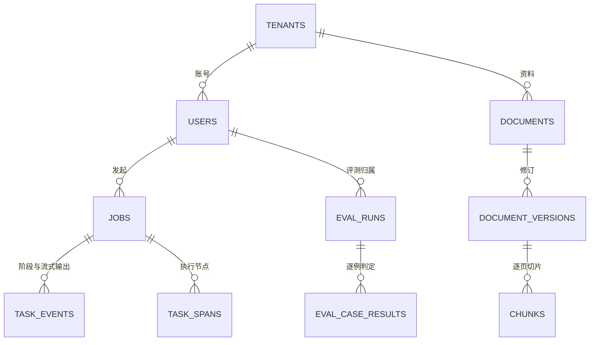

# 数据库模型

部署版本的表结构以 Alembic 迁移为准。初始定义记载通用实体和约束，后续迁移增加向量索引、任务事件、轨迹与评测表。[基础表](../src/taozhi/server/schema.sql) · [版本迁移](../migrations/versions/)

## 数据归属

| 业务域 | 主要表 | 读取规则 |
| --- | --- | --- |
| 身份和组织 | `tenants`、`users`、`org_nodes`、`memberships`、`sessions` | 会话绑定主体版本。用租户和组织关系推导访问范围。 |
| 文档与检索 | `documents`、`document_versions`、`chunks`、`knowledge_mentions`、`embedding_cache` | 文档版本保留原件指针和提取正文。切片记录原文页码，已发布文档按来源、密级和个人授权过滤。 |
| 审批与授权 | `approvals`、`document_grants`、`metric_grants` | 审批和明确授权均按租户处理，读取时复核对象及期效。 |
| 异步任务 | `jobs`、`task_events`、`task_outbox`、`task_reviews`、`worker_heartbeats` | 任务按租户与发起人归属，执行版本和租约用于隔离重试。结果与事件按当前资料权限读取。 |
| 经营数据 | `metrics`、`products`、`skus`、`channels`、`orders`、`after_sales`、`stock` | ChatBI 通过获授权的指标模板执行只读查询，结果保留指标来源。实时订单和库存也可经企业网关读取。 |
| 审计与轨迹 | `audit_events`、`model_calls`、`task_spans` | 通过任务编号、执行版本和 Trace ID 查调用步骤、用量和诊断。 |
| 评测 | `eval_runs`、`eval_case_results` | 批次记录发起人、版本和门禁，明细保留用例判定、预期和采集步骤。两者同事务写入，可按批次追溯。 |

系统管理员可按发起人查本租户轨迹。资料正文和业务结果另行校验权限。[访问规则](../src/taozhi/infrastructure/persistence/access_repo.py) · [轨迹查询](../src/taozhi/application/services/trace_service.py)

## 文档版本与执行记录

- `documents.current_version` 指向当前版本。`acl_version` 用于判断历史引用及缓存的权限有效性。原件由附件存储适配器按租户保存。
- `chunks.embedding` 使用 pgvector，页面引用按切片的文档版本和页码展示。文本检索和向量检索使用同一份可读文档范围。[向量迁移](../migrations/versions/006_pgvector.py) · [文档仓储](../src/taozhi/infrastructure/persistence/document_repo.py)
- `jobs.run_version` 区分同一任务的尝试。SSE 通过递增事件编号恢复。`task_spans` 保存节点的父子关系与经过筛选的诊断，评测可以引用对应 Trace ID。[事件迁移](../migrations/versions/017_task_output_events.py) · [轨迹迁移](../migrations/versions/014_task_spans.py) · [评测迁移](../migrations/versions/020_evaluation_center.py)
