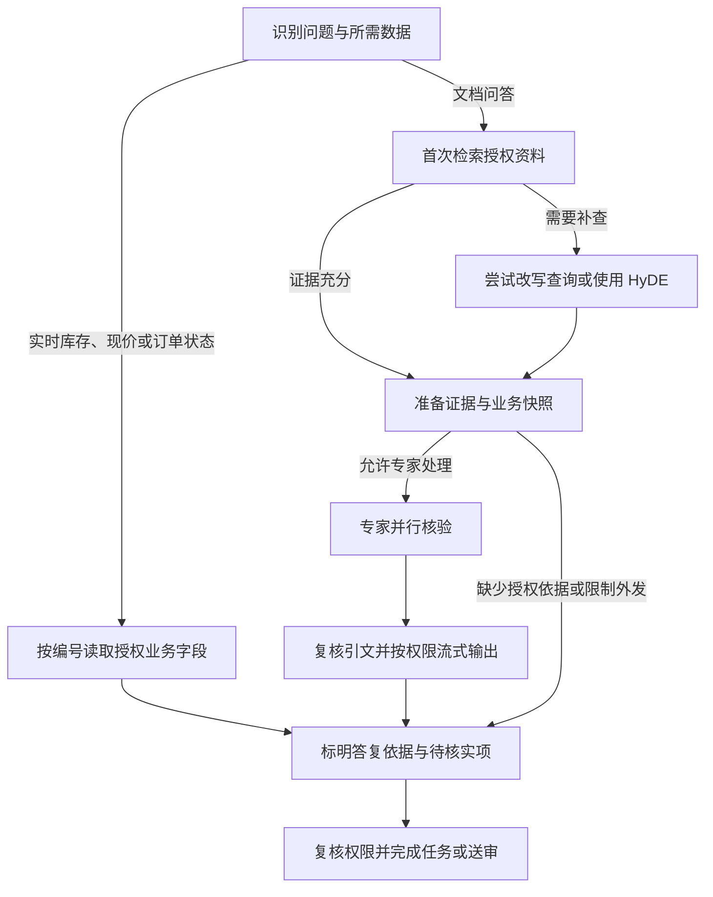
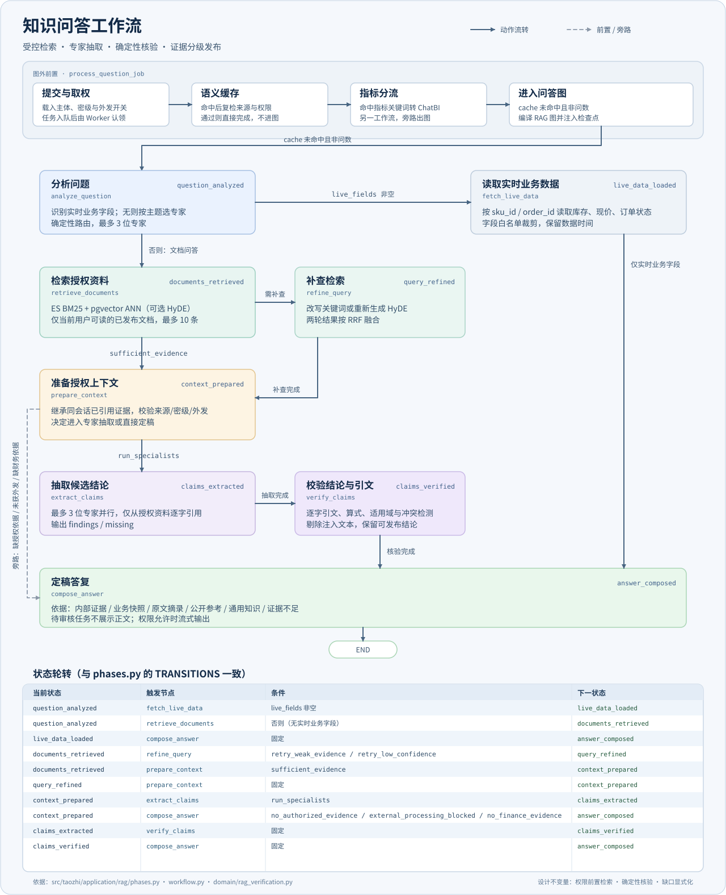

# 手机配件资料与问答

## 按用途选资料

| 要核实的内容 | 可用依据 |
| --- | --- |
| 市售商品参数、机型适配与操作 | 对应型号、地区和版本的厂商规格书、手册或兼容表 |
| 钢化膜、保护壳或充电设备的性能 | 标明样品型号、测试条件与方法的原始报告 |
| 充电接口、合规与安全 | 适用市场的法规、监管机构指引和召回公告，按文档日期核对 |
| 产品设计与行业调研 | 专利、开放硬件文档和研究论文，保留文档类型与实验条件 |
| 本店保修、售价、库存和订单 | 已授权的内部政策、价表或实时业务系统记录 |

配件目录直接存放 PDF 原件。按清单中的分类、发布方、型号和地区筛选，从每条记录的 `file` 读取仓库内的 PDF。发布方、来源和许可随原件登记。[配件目录](../../data/accessory_pdfs/) · [机器可读清单](../../data/accessory_pdfs/manifest.json)

## 提取与导入

1. 以清单的文件路径读取 PDF，核对 SHA-256。保留发布方、型号、地区、版本和原件页码，便于后续按页切片和引用。
2. 自行生成词嵌入时，分别整理厂商说明、检测报告与企业政策的适用范围。资料存在新版时，保留各自版本和适用型号。整份扫描件由入库流程按页回退 OCR 识别。
3. 如需通过工作台管理资料，在「知识文档」上传 PDF 并设置组织、范围和密级。Worker 提取正文，记录页码并提交发布审核。使用现有解析器时，单份 PDF 上限为 20 MiB、200 页和 20 万正文字符；文本层为空的页面会自动走 OCR，可用 `ECOM_OCR_ENABLED=false` 关闭。
4. 发布后提交包含完整型号、销售地区或业务编号的问题。使用答案编号打开相应引文，按文档版本和页码核对。遇到「依据不足」时，可从页面补充条件再问。

仓库交付原件与清单。企业资料的发布、外部 AI 处理和下载按各自授权执行。[数据目录](../../data/README.md) · [文档权限规则](../../src/taozhi/domain/access.py)

## 问答执行路径

文档问答最多分派给 3 位业务专家。首次检索证据不足，或启用自适应 HyDE 后精排置信度偏低时，工作流最多补查一次。两轮结果按倒数排名融合（RRF）保留至多 10 条文档证据。核验检查引文、机型和适用条件，结果页分别列出正文采用的来源和仅在检索中出现的资料。明确询问实时库存、现价或订单状态时，工作流按业务编号读取授权系统。轨迹中台记录本次实际经过的节点。[图定义](../../src/taozhi/application/rag/workflow.py) · [事实核验](../../src/taozhi/domain/rag_verification.py)

状态轮转与节点命名见下图（与 [`phases.py`](../../src/taozhi/application/rag/phases.py) 一致）：

符合缓存条件的独立问答还可在进入图之前复用已核验答复，命中时会重新检查引用权限。实时业务查询、依赖上文的追问和明确要求只看授权原文的问题各自执行本次工作流。需要审核的任务在批准前不向提问者展示答复正文。[问答执行入口](../../src/taozhi/application/rag/execution.py)

| 提问与资料情况 | 用户看到的答复 |
| --- | --- |
| 「本店的保修期是多久？」 | 以有效的内部条款为准。资料缺失时列出待核实项，并提示向售后负责人补充购买渠道、日期和生效条款。 |
| 「什么是 USB PD？」 | 内部依据不足且选择「企业资料与官方公开参考」时，展示内置释义和 USB-IF 原文链接。当前公开参考覆盖 USB-C、USB PD、低功耗蓝牙、GTIN 和 SKU，均在本地匹配。 |
| 「这个商品的实时库存是多少？」 | 填写商品编号后展示业务系统返回的可用库存。缺少编号、权限或所需字段时，页面说明查询缺口。 |
| 「现在有货吗？保修多久？」 | 先给出可核实的库存，另列待核实的保修条件。用户可以选择「补充条件再问」，附上适用渠道和型号。 |
| 同一机型、同一适用条件下，资料给出两个保修期限 | 可识别的直接冲突进入待核实事项，按编号核对两份原文。其余有独立依据的结论仍可展示。 |
| 有相关授权原文，但未获准外发或核验模型不可用 | 页面说明原因，并提供相应片段和文档版本，供人工核对。使用公开参考与允许外部 AI 处理资料是两个独立选项。 |
